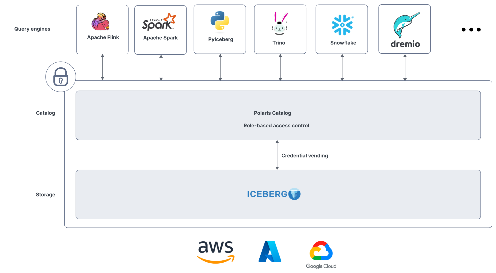
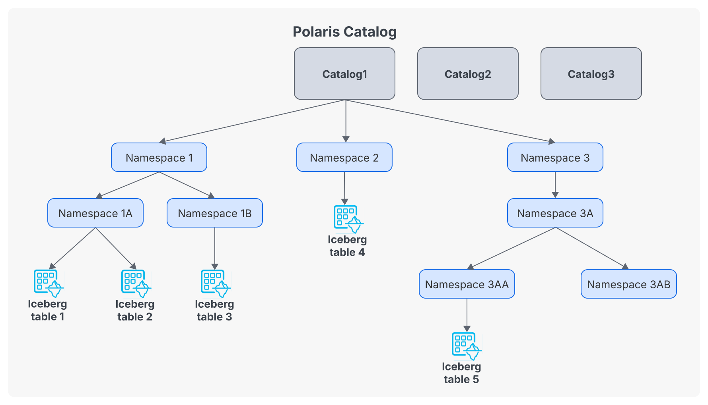
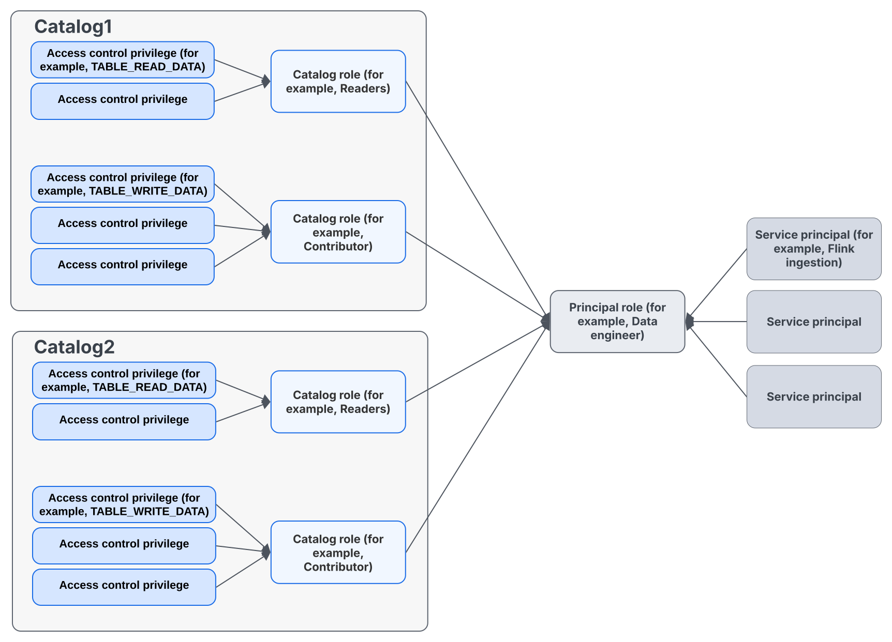

# Apache Polaris

[Apache Polaris](https://polaris.apache.org/) is an open-source, cloud-native catalog for [Apache Iceberg](https://iceberg.apache.org/). It provides a centralized way for multiple compute engines to discover and manage Iceberg tables. It also implements the Iceberg REST Catalog specification, enabling multiple compute engines to share a single, consistent view of the data lakehouse. Polaris utilizes a centralized security model to enforce fine-grained access control and credential vending, ensuring that stored data remains secure and audited. It provides a unified management layer for Iceberg tables, simplifying the orchestration of complex data architectures while maintaining strict data governance across the entire analytical stack.



Polaris exposes two APIs:

- **Catalog API** (`/api/catalog`): the Iceberg REST specification used by the engines
- **Management API** (`/api/management/v1`): creates catalogs, principals, roles and grants

## Key concepts



### Catalog

An Iceberg table consists of metadata and data files stored in object storage. The catalog is the service that lets multiple engines **discover and manage those Iceberg tables** without each engine having to manage table registration and commit coordination itself. The catalog does not store the table's data and does not execute queries.

**Naming:** The catalog maps a table name such as `silver.orders` to the Iceberg table and its current metadata. Engines therefore do not need to know the location of the table's metadata in advance.

**Commit coordination:** When a writer wants to modify a table, it sends the requested changes and the conditions under which the changes are valid to the catalog. The catalog checks those conditions against the current table state. If another writer has changed the table in the meantime, the commit is rejected and the writer can refresh the table and retry. This prevents concurrent writers from silently overwriting each other's changes.

**Access control:** In a service such as Apache Polaris, the catalog authenticates clients and applies authorization policies to determine who can access catalogs, namespaces and tables, and what operations they may perform. Polaris can also control how clients obtain access to the underlying object storage.

### Namespace

In Apache Polaris, a namespace is a logical container used to organize Iceberg tables within a catalog. It is similar to a database or schema in a traditional database system: instead of having tables directly under the catalog, tables are grouped into namespaces such as `silver` or `gold`, giving names such as `silver.users` and `gold.orders`. A namespace can also have properties and access-control policies associated with it, allowing administrators to manage groups of tables together. The namespace is a catalog-level concept; it does not necessarily correspond to a directory in S3.

## Entities

Apache Polaris manages access to Iceberg data through a set of related entities. Understanding these entities helps explain how users and applications are authenticated, how permissions are grouped, and how those permissions are applied to catalogs and tables.

```text
Polaris
└── Catalog: lakehouse
    ├── Namespace: silver
    │   ├── Table: users
    │   └── Table: orders
    └── Namespace: gold
        └── Table: sales_by_state_month
```

- **Catalog**  
  The top-level container and the unit of storage configuration. An internal catalog is owned by Polaris. An external catalog federates a catalog managed elsewhere, which remains the source of truth.

- **Namespace**  
  A logical container used to organize tables and views within a catalog. For example, `silver` can contain tables such as `silver.users` and `silver.orders`. A namespace can also have its own properties and access-control policies.

- **Table and view**  
  The Iceberg objects registered in a namespace.

- **Principal**  
  An identity that interacts with Polaris, such as a user or an application. Principals are the subjects to which roles and permissions are assigned.

- **Principal Role**  
  A role assigned to a principal. It groups the permissions that a particular user or application receives, making access management easier than assigning permissions individually.

- **Catalog Role**  
  A role defined within a catalog that groups a set of privileges. Principal roles can be granted catalog roles, allowing the same collection of permissions to be reused across principals.

- **Policy**  
  A set of rules that controls how resources can be accessed. Policies associate roles with resources and determine which operations are allowed or denied.

- **Privilege**  
  A specific permission to perform an operation on a resource, such as reading a table, creating a table, or modifying data. Privileges are the building blocks used to define what a role can do. For a list of supported privileges for each privilege class, see [the OpenAPI](https://github.com/apache/polaris/blob/main/spec/polaris-management-service.yml).

## Storage configuration

Each catalog declares where its tables live and how to reach the object store:

| Setting           | Description                                                                       |
| ----------------- | --------------------------------------------------------------------------------- |
| Base location     | Default location of the new tables, `s3://lakehouse/`                             |
| Allowed locations | The only locations tables of the catalog may use                                  |
| Endpoint          | The S3 API endpoint, required for S3-compatible storage such as Ceph RGW or MinIO |
| Path-style access | Bucket in the path instead of the hostname, often required outside AWS            |
| Role and STS      | The role Polaris assumes to generate temporary credentials                        |

## Credential vending

Without a catalog, every engine holds S3 keys giving access to the whole bucket. Whatever access rules exist elsewhere, anybody with the keys bypasses them.

With credential vending, the engines do not hold S3 keys. They authenticate to Polaris, which checks the privileges and returns temporary credentials limited to the location of the requested table, read-only or read-write depending on the privileges of the user:

```text
Spark ── 1. load table silver.users, with token ──────────────► Polaris
                                                                 checks the privileges
Spark ◄─ 2. metadata location + temporary S3 credentials ────────┘
Spark ── 3. read metadata and data files with them ───────────► S3
```

The client requests it with the header `X-Iceberg-Access-Delegation: vended-credentials`. The object store must provide an STS-compatible service to issue the temporary credentials. Without it, static credentials have to be configured, and access control is enforced by the catalog only: a user with the bucket keys can still read the files directly.

## Authentication

A principal, the identity of a user or a service, authenticates with the OAuth2 client credentials flow. Polaris returns a bearer token sent with every request:

```bash
curl -s http://polaris:8181/api/catalog/v1/oauth/tokens \
  -d grant_type=client_credentials \
  -d client_id=$CLIENT_ID \
  -d client_secret=$CLIENT_SECRET \
  -d scope=PRINCIPAL_ROLE:ALL
```

The credentials of the `root` principal are created when Polaris is bootstrapped. Like a root account, it is used to set up the catalogs and the roles, not for daily work. In production, Polaris delegates the authentication to an identity provider such as Keycloak through OpenID Connect, and the token claims are mapped to principals.

### Role-based access control

Polaris uses two levels of roles:

```text
Principal ──► Principal role ──► Catalog role ──► Privileges ──► Catalog, namespace, table or view
 (user or       (job function,      (privileges         TABLE_READ_DATA
  service)       cross-catalog)      in one catalog)    TABLE_WRITE_DATA
```

- **Principal**: a user or a service, for example the Spark job of the pipeline
- **Principal role**: a job function shared across catalogs, `data_engineer`, `data_analyst`
- **Catalog role**: a named set of privileges inside one catalog, defined by the owner of the catalog
- **Privilege**: an action on a securable object

The two levels separate concerns. The catalog owner decides what a `silver_reader` can do in their catalog. The administrator decides which people are `data_analyst`. Privileges granted on a catalog or a namespace apply to all the objects below.

| Privilege                | Allows                                                                                                                                                                       |
| ------------------------ | ---------------------------------------------------------------------------------------------------------------------------------------------------------------------------- |
| `NAMESPACE_LIST`         | List the namespaces                                                                                                                                                          |
| `TABLE_LIST`             | List the tables of a namespace                                                                                                                                               |
| `TABLE_READ_PROPERTIES`  | Load a table and its metadata                                                                                                                                                |
| `TABLE_READ_DATA`        | Read the data, and get read credentials                                                                                                                                      |
| `TABLE_WRITE_DATA`       | Write the data, and get write credentials                                                                                                                                    |
| `TABLE_CREATE`           | Create tables                                                                                                                                                                |
| `CATALOG_MANAGE_CONTENT` | Manage all the content of the catalog                                                                                                                                        |
| `CATALOG_MANAGE_ACCESS`  | Grant and revoke privileges in the A catalog such as Polaris is part of the metadata and governance ecosystem, but it is not a general-purpose enterprise metadata platform. |
| catalog                  |

A possible mapping of the medallion layers:

| Principal role   | Catalog role    | Privileges             | On               |
| ---------------- | --------------- | ---------------------- | ---------------- |
| `data_engineer`  | `layers_writer` | Create, read and write | `silver`, `gold` |
| `data_scientist` | `silver_reader` | List, read             | `silver`         |
| `data_analyst`   | `gold_reader`   | List, read             | `gold`           |



## Example: register the Silver table

The Silver table written by the Spark DataFrame lab already exists in S3 with its Iceberg metadata, but no shared catalog knows about it. It can be registered in Polaris without copying the data, from a Spark session whose `polaris` catalog points to the Polaris URL and uses the credentials of a principal allowed to create tables.

```sql
CREATE NAMESPACE IF NOT EXISTS polaris.silver;
CALL polaris.system.register_table(
  table => 'silver.users',
  metadata_file => 's3://lakehouse/silver/users/metadata/00002-<uuid>.metadata.json'
);
SELECT count(*) FROM polaris.silver.users;
```

The table location must be inside the allowed locations of the Polaris catalog. Once registered, write to the table through Polaris only, since another catalog still pointing at the old metadata file would diverge.

## Several engines, one catalog

The same catalog serves every engine. Spark writes the Silver tables, Trino reads them to build the Gold tables in the next module, and both are subject to the same roles:

```text
 Spark ──┐                                  ┌── Silver: users, orders
         ├──► Polaris (RBAC, credentials) ──┤
 Trino ──┘            │                     └── Gold: sales_by_state_month
                      ▼
                  S3 (Iceberg data and metadata files)
```

## Data governance

Data governance is the set of policies, roles and processes ensuring that data is findable, trustworthy, secure and compliant. It is an organizational practice first. The tools only enforce or document decisions made by people.

| Pillar         | Question                             | Typical tools                                          |
| -------------- | ------------------------------------ | ------------------------------------------------------ |
| Access control | Who can read or write what?          | Polaris roles, credential vending, bucket policies     |
| Discovery      | What data exists, and where?         | Catalog, OpenMetadata, DataHub                         |
| Lineage        | Where does this dataset come from?   | dbt docs, OpenLineage, DataHub                         |
| Quality        | Can I trust it?                      | dbt tests, Great Expectations, Soda                    |
| Privacy        | Where is the PII, when is it erased? | Masking in Silver, Iceberg deletes and snapshot expiry |
| Ownership      | Who answers for this dataset?        | Data contracts, documentation, stewards                |

The medallion module stated that each layer needs a contract: what it guarantees, who owns it, who may read it. The roles above are the enforcement of the "who may read it" clause.

## References

- [Apache Polaris documentation](https://polaris.apache.org/)
- Tomer Shiran, Jason Hughes and Alex Merced, _Apache Iceberg: The Definitive Guide_, O'Reilly, 2024
- Joe Reis and Matt Housley, _Fundamentals of Data Engineering_, O'Reilly, 2022

---

_The content of this document, including all text, images, and associated materials, is the exclusive property of
Adaltas and is protected by applicable copyright laws. Unauthorized distribution, reproduction, or sharing of this
content, in whole or in part, is strictly prohibited without the express written consent of the author(s). Any violation
of this restriction may result in legal action and the imposition of penalties as prescribed by law._
