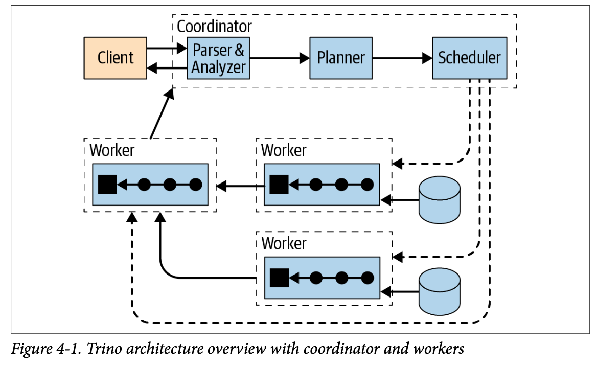

# Trino introduction

## Trino in the data ecosystem


## What is Trino

- Fast, distributed (parallel), **SQL query engine** for analytics
- **Open Source** project [trino.io](https://trino.io/docs/current/) (Apache License 2.0)
- Originally created at **Facebook** (Presto, 2012), forked and renamed **Trino** in 2020 by the original creators
- Written in **Java** → runs in the JVM (Java Virtual Machine)
- One language: **ANSI SQL** — clients exist for CLI, JDBC, Python, and BI tools
- **MPP** (Massively Parallel Processing) architecture: queries are split into **tasks** run in parallel on **worker nodes**
- **Not a database**: no storage of its own, data stays in the source systems
- Designed for **interactive analytics** (seconds to minutes), not for OLTP

## Use cases

- **Interactive analytics** on very large datasets stored in an object store (S3) or HDFS
- **Federated queries**: join data across heterogeneous sources in a single SQL statement (Iceberg, PostgreSQL, Kafka, ...)
- **ETL / ELT** with SQL: `CREATE TABLE AS`, `INSERT`, `MERGE` to build silver and gold layers
- **Lakehouse query layer**: serve BI tools and data analysts on Iceberg tables

## Trino vs Spark


| Criteria        | Trino                                          | Spark                                     |
| --------------- | ---------------------------------------------- | ----------------------------------------- |
| Main interface  | SQL                                            | Scala, Python, R, SQL, Java               |
| Execution model | Pipelined, in-memory between stages            | Stage by stage, shuffle can spill to disk |
| Latency         | Low (interactive)                              | Higher (job startup, batch-oriented)      |
| Fault tolerance | Query fails by default (optional retry mode)   | Lost partitions recomputed from lineage   |
| Best for        | Ad hoc queries, BI, federation, SQL transforms | Large ETL, ML, streaming, custom code     |

> Both engines are complementary: Spark for heavy transformations and ML, Trino for fast SQL access to the results.

## Architecture

## Trino architecture



Trino is a distributed system composed of one **coordinator** and zero or several **workers**.

### Coordinator

The coordinator receives the SQL query and manages its execution.

Its responsibilities include:

- parsing SQL
- analyzing the query
- creating the query plan
- finding the required tables
- scheduling work on workers
- collecting the final result
- communicating with workers and clients using a REST API

The coordinator normally does not perform all the data processing itself.

### Workers

Workers execute the tasks created by the coordinator.

Its responsibilities include:

- execute **tasks** assigned by the coordinator
- read data from sources through **connectors**
- exchange intermediate results with other workers

```text
orders table

data-001.parquet ──────► Worker 1
data-002.parquet ──────► Worker 2
data-003.parquet ──────► Worker 3
data-004.parquet ──────► Worker 1
```

This distributed execution is what allows Trino to query large datasets in parallel.

### Client

Clients provide the interface through which users and applications interact with Trino. They connect to the Trino coordinator, submit SQL queries, and receive query results.

Trino supports several types of clients, including:

- Command-line clients, such as the Trino CLI, for interactive SQL queries.
- JDBC and ODBC clients, which allow applications and BI tools to connect to Trino using standard database connectivity interfaces.
- BI and visualization tools, which can use Trino as a SQL data source to build dashboards, reports, and interactive queries.
- Custom applications, which can interact with Trino through its HTTP-based client protocol or through supported client libraries.

Clients submit queries to the Trino coordinator, which parses and plans the SQL statement before distributing the execution work to worker nodes. The client does not directly connect to individual workers.

Through Trino's catalogs, a client can query data exposed by different connectors using a common SQL interface. A single query can therefore access data from one or multiple data sources, depending on the configured connectors and catalogs.

Applications or tools that use a different query language or provide a graphical query builder generally need to translate their requests into Trino-compatible SQL before submitting them to Trino.

## Catalogs, schemas and tables

Trino addresses data with a **three-level namespace**:

```text
catalog.schema.table
```

- Connector: plugin that knows how to read (and sometimes write) one type of data source
- [Catalog](https://trino.io/docs/current/overview/concepts.html#catalog): a configured instance of a connector, defined by a `.properties` file
- [Schema](https://trino.io/docs/current/overview/concepts.html#schema): a set of tables inside a catalog (a database in PostgreSQL, a namespace in Iceberg)
- [Tables](https://trino.io/docs/current/overview/concepts.html#table): the data itself, exposed as rows and columns

This three-level structure perfectly matches with [PostgreSQL](https://trino.io/docs/current/connector/postgresql.html#configuration) as it is a three-level architecture (it owns schemas and tables). For example, a table named `orders` located inside the native `public` schema of the `sales_db` database is queried via `postgres_prod.public.orders` with the below associated sample catalog configuration. The catalog name `postgres_prod` refers to the database `sales_db`.

```sql
SHOW CATALOGS;
SHOW SCHEMAS FROM sales_db;
SHOW TABLES FROM sales_db.public;
SELECT * FROM sales_db.public.orders LIMIT 10;
```

Common connectors: **Iceberg**, Hive, Delta Lake, PostgreSQL, MySQL, Kafka, MongoDB, TPC-H (benchmark data).

## Query execution


When a query statement is submitted, Trino:

1. **Parses** the SQL and **analyzes** it (tables, columns, types, permissions)
2. Builds a **logical plan** and **optimizes** it (cost-based optimizer)
3. Splits the plan into **stages** (**fragments**)
4. Each stage is run as **tasks** distributed over a network of Trino workers
5. Tasks process **splits**, chunks of data read from the source
6. Results flow between stages through **exchanges**, then back to the client

| Concept    | Description                                                                |
| ---------- | -------------------------------------------------------------------------- |
| **Query**  | One SQL statement, executed across the cluster                             |
| **Stage**  | A fragment of the plan; stages form a tree, the root stage returns results |
| **Task**   | A stage instance running on a worker                                       |
| **Split**  | A unit of data (e.g. a part of a Parquet file) processed by a task         |
| **Driver** | A pipeline of operators processing a split inside a task                   |

- Data is **pipelined** between stages in memory: no intermediate write to disk by default
- **Exchanges** (shuffles over the network) are the main cost of distributed joins and aggregations
- Optimizations: **predicate pushdown**, **column pruning**, **partition pruning**, join reordering

## Fault tolerance

- By default, a worker failure **fails the query**: it must be re-run from the beginning
  - Acceptable for short interactive queries, costly for long ETL queries
- **Fault-tolerant execution** (opt-in) retries failed tasks or whole queries:
  - `retry-policy=TASK` or `retry-policy=QUERY`
  - requires an **exchange manager** that spools intermediate data to external storage (S3)

## Trino on Iceberg


The **Iceberg connector** lets Trino read and write Iceberg tables. The table metadata is managed by an Iceberg **catalog**; the course uses **Apache Polaris** through the Iceberg **REST catalog** protocol. Data files stay in S3.

```properties
# etc/catalog/lakehouse.properties
connector.name=iceberg
iceberg.catalog.type=rest
iceberg.rest-catalog.uri=<polaris_catalog_uri>
iceberg.rest-catalog.warehouse=<polaris_catalog_name>
iceberg.rest-catalog.security=OAUTH2
iceberg.rest-catalog.oauth2.credential=<client_id>:<client_secret>
iceberg.rest-catalog.oauth2.scope=PRINCIPAL_ROLE:<principal_role>
fs.native-s3.enabled=true
s3.endpoint=<s3_endpoint>
s3.path-style-access=true
s3.region=<s3_region>
```

- Trino authenticates to Polaris with **OAuth2** (client credentials): permissions are enforced by the Polaris roles
- Trino reads and writes the data files in S3 directly with its **native S3 file system**
- Iceberg features available from SQL:
  - **ACID** writes: `INSERT`, `UPDATE`, `DELETE`, `MERGE`
  - **Time travel**: query a previous snapshot
  - **Metadata tables**: `"table$snapshots"`, `"table$files"`, `"table$history"`
  - **Maintenance**: `ALTER TABLE ... EXECUTE optimize`, `expire_snapshots`

```sql
-- Snapshots of a table
SELECT snapshot_id, committed_at, operation
FROM lakehouse.silver."orders$snapshots";

-- Time travel
SELECT count(*)
FROM lakehouse.silver.orders FOR VERSION AS OF 1234567890123456789;
```

## From silver to gold


In the medallion architecture, Trino builds the **gold** layer from the **silver** layer with plain SQL:

```sql
CREATE SCHEMA IF NOT EXISTS lakehouse.gold;

CREATE TABLE lakehouse.gold.revenue_by_country AS
SELECT
  u.country,
  date_trunc('month', o.order_date) AS month,
  count(*)                          AS orders,
  sum(o.amount)                     AS revenue
FROM lakehouse.silver.orders AS o
JOIN lakehouse.silver.users  AS u ON u.user_id = o.user_id
GROUP BY 1, 2;
```

- The result is a new **Iceberg table**, readable by any engine connected to the same catalog
- Gold tables are **aggregated**, business-oriented and ready for BI tools
- To refresh a gold table, use `INSERT`, `MERGE` or `CREATE OR REPLACE TABLE`

## References

- [Trino documentation](https://trino.io/docs/current/)
- [Trino Iceberg connector](https://trino.io/docs/current/connector/iceberg.html)
- [Trino fault-tolerant execution](https://trino.io/docs/current/admin/fault-tolerant-execution.html)
- [Apache Iceberg REST catalog specification](https://iceberg.apache.org/rest-catalog-spec/)

---

_The content of this document, including all text, images, and associated materials, is the exclusive property of Adaltas and is protected by applicable copyright laws. Unauthorized distribution, reproduction, or sharing of this content, in whole or in part, is strictly prohibited without the express written consent of the author(s). Any violation of this restriction may result in legal action and the imposition of penalties as prescribed by law._
