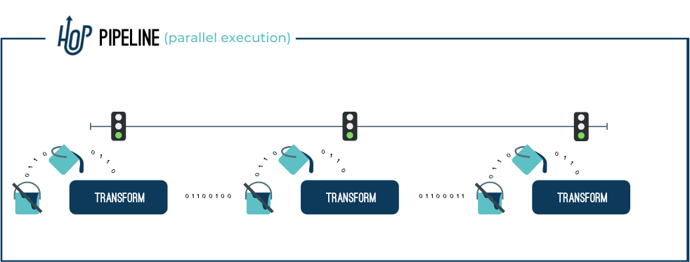
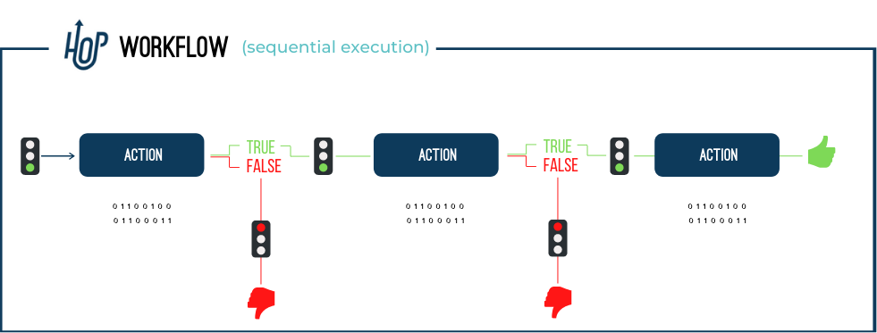
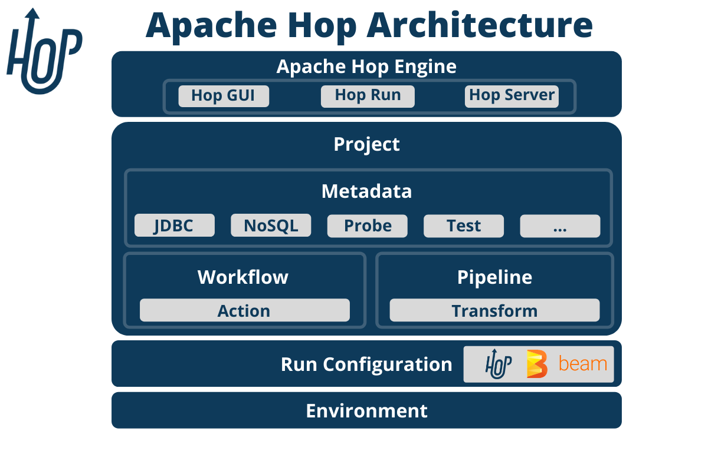

# Apache Hop

## What is Apache Hop

Apache Hop (Hop Orchestration Platform) is an open-source, visual data engineering and orchestration platform designed to simplify the entire data lifecycle. Hop uses a metadata-driven approach that allows teams to design complex data pipelines and workflows through a graphical interface without writing code. It provides a flexible runtime environment, enabling the same pipeline to run locally, on a cluster, or via engines like Apache Spark. Apache Hop separates the design logic from the execution engine, enabling data engineers to build secure, maintainable, reusable, and platform-independent data solutions that scale from edge devices to massive cloud environments.

## Core concepts

### Metadata

Metadata is at the core of everything in Hop. The principle is that logic and configuration are kept apart: a pipeline describes what to do, and Metadata objects describe where and with what.

### Transform

- A transform is the unit of work of a pipeline
- Typical operations: read files or databases, lookups and joins, enrich and clean data, write the result
- Transforms are the data workers: they process the rows that flow through the pipeline
- All transforms of a pipeline start together and process data in parallel

Examples seen in this module: `CSV File Input`, `Select Values`, `Filter Rows`, `Group By`, `Parquet File Output`.

### Action

- An action is one operation performed in a workflow
- Typical tasks: retrieve and archive data, send an email, handle errors
- An action returns a true or false exit code, which the workflow can use or ignore
- Actions run sequentially by default, with optional parallel execution
- Running a pipeline is itself an action: that is how a workflow orchestrates pipelines

### Hop

- A hop links two transforms in a pipeline, or two actions in a workflow
- The two uses behave differently:

| In a pipeline                                                             | In a workflow                                       |
| ------------------------------------------------------------------------- | --------------------------------------------------- |
| Passes data between transforms                                            | Decides what runs next from the exit status         |
| Only buffers and passes rows, knows nothing of the transforms it connects | Carries a condition on the previous action's result |
| Uni-directional, no loops: a pipeline is a DAG                            | Typically no data, just control flow                |
| Several hops out of a transform: rows are distributed or copied           | One hop per outcome (see below)                     |

- Pipeline hops with several outputs: distribute sends each row to one of the next transforms, copy sends every row to all of them
- Some transforms produce special hops, e.g. `Filter Rows` evaluates a condition on each row and has a true and a false output

### Pipeline

- A pipeline (`.hpl`) is a directed acyclic graph of transforms connected by Hops
- All transforms run in parallel, and data flows between them over the hops.
- A Hop is a buffer (row set) between two transforms
- Rows of a transform have a defined layout: field names and types (see [Schema management in Hop](#schema-management-in-hop))

```
`CSV File Input` ──► `Select Values` ──► `Filter Rows` ──► `Parquet File Output`
```



### Workflow

- A workflow (`.hwf`) is a set of actions connected by hops
- Actions run in sequence: the next one starts when the previous one finishes
- Hops carry a condition: success, failure or unconditional
- Typical actions: run a pipeline, run a SQL script, check that a file exists, send a mail, call another workflow

| Pipeline                   | Workflow                  |
| -------------------------- | ------------------------- |
| Moves and transforms rows  | Orchestrates tasks        |
| Transforms run in parallel | Actions run in sequence   |
| Hop = flow of data         | Hop = order and condition |
| Unit of work: a transform  | Unit of work: an action   |



### Projects and environments

- A project is a folder holding pipelines, workflows and metadata
- An environment points to a project and sets its variables (dev, test, prod)
- Variables (`${PROJECT_HOME}`, `${S3_ENDPOINT}`) change between environments, parameters (`${INPUT_PATH}`) change between runs
- No credentials in the pipeline: they live in the environment, not in the code that is committed

## Architecture and tools



| Tool         | Role                                                            |
| ------------ | --------------------------------------------------------------- |
| `hop-gui`    | Desktop designer: build, preview, debug                         |
| Hop Web      | Same designer in a browser, served from a container             |
| `hop-run`    | Run a pipeline or a workflow from the command line              |
| `hop-conf`   | Manage projects, environments, metadata from the command line   |
| `hop-server` | Web server that runs pipelines and workflows submitted remotely |

The typical flow: design in Hop GUI, commit the files to Git, execute with `hop-run` (or `hop-server`) from a scheduler or a Kubernetes job.

## Essential transforms

| Category  | Transforms                                                                          |
| --------- | ----------------------------------------------------------------------------------- |
| Input     | `CSV File Input`, `Table Input`, `Parquet File Input`, `Generate Rows`, `Data Grid` |
| Output    | `Table Output`, `Parquet File Output`, `Text File Output`                           |
| Cleaning  | `Select Values`, `Filter Rows`, `Replace in String`, `Value Mapper`, `Calculator`   |
| Reshaping | `Sort Rows`, `Group By`, `Row Denormaliser`, `Split Fields`                         |
| Combining | `Merge Join`, `Stream Lookup`, `Database Lookup`, `Append Streams`                  |
| Routing   | `Switch / Case`, `Filter Rows`, `Dummy` (do nothing)                                |

- `Select Values`: choose, rename, reorder fields, change types — the equivalent of `df.select(...)`
- `Filter Rows`: send rows to one transform if the condition is true, another if false — the equivalent of `df.filter(...)`
- `Group By` and `Merge Join` need sorted input; add a `Sort Rows` before them
- Files can be read from and written to object storage through Hop's virtual filesystem (`s3://bucket/path`)

## Schema management in Hop

Every hop carries a row layout: field names, types and lengths. A transform needs it before it can run, so an input transform must produce one, either guessed or declared.

- Fields guessed with Get Fields
- Fields declared and kept as-is

## Demo: a first pipeline

Live build in Hop Web, on the orders dataset used in the previous labs:

1. `CSV File Input`: read `orders.csv` with declared fields.
2. `Select Values`: rename `uuid` to `order_id`, cast `quantity` to `Integer`.
3. `Filter Rows`: keep `quantity > 0`, observe the true and the false outputs.
4. `Text File Output` (or preview): show the result.
5. Run it, then read the transform metrics: rows read, written, speed.

The lab continues with the users dataset and the Parquet output.

---

_The content of this document, including all text, images, and associated materials, is the exclusive property of Adaltas and is protected by applicable copyright laws. Unauthorized distribution, reproduction, or sharing of this content, in whole or in part, is strictly prohibited without the express written consent of the author(s). Any violation of this restriction may result in legal action and the imposition of penalties as prescribed by law._
