# Lab: Bronze to silver with Hop

Use Apache Hop Web, running in a local container, to construct a bronze to silver pipeline. This lab uses Apache Hop Web 2.19.0. Use the same version when pulling and running the container image.

## Objectives

- Run Hop Web in Docker on your laptop and create the `hop-project` project
- Build the silver `users` pipeline with an approach similar to the [Spark lab](../07.sparksql-and-dataframes/lab-pyspark-silver.md)
- Read and run the provided silver `orders` [pipeline](./lab/pipelines/silver-orders.hpl)
- Check the result using DuckDB

## Prerequisites

- Docker installed on your computer, and the Hop Web image pulled before the session:

  ```bash
  docker pull apache/hop-web:2.19.0
  ```

- The bronze CSV files `users.csv` and `orders.csv`, downloaded from the S3 bucket `s3://<user-name>/bronze/`. You may retrieve these files from your lab repository.

- Place the downloaded CSV files in the `bronze` directory of your lab repository. First change to your repository directory on your laptop, then prepare the lab directory and data.

  ```bash
  GIT_REPO_NAME=<git-repo-name>
  cd $GIT_REPO_NAME
  mkdir -p ./lab_hop/hop-project/data/bronze
  mv users.csv orders.csv ./lab_hop/hop-project/data/bronze
  cd ./lab_hop
  ```

## Start Hop Web

Start the Hop Web container on your computer.

```bash
docker run -d --name hop-web -p 8080:8080 \
  apache/hop-web:2.19.0
```

If the container already exists, start it with the following command.

```bash
docker start hop-web
```

Open http://localhost:8080. The Hop Web interface is ready to use.

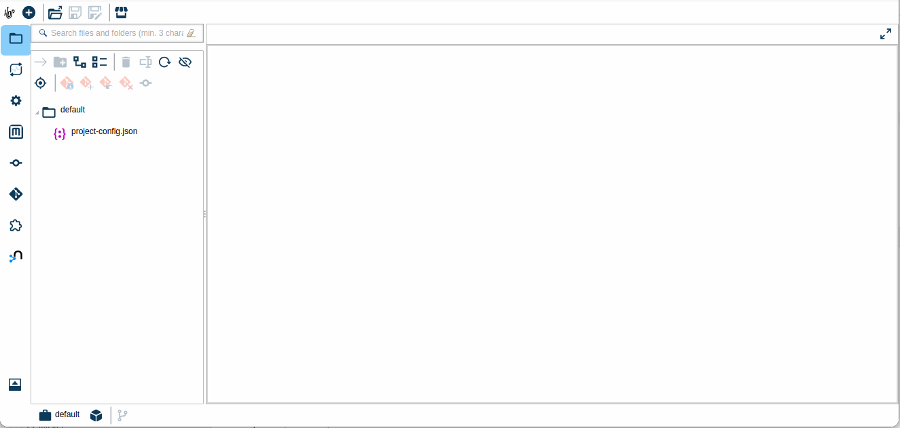

## Project registration

Perform the following steps in the "Hop Web" web page.

First, register the project with the "suitcase" button in the bottom-left corner.

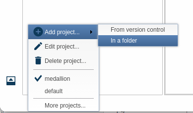

Enter the following values in the dialog box.

- "Name": `hop-project`
- "Home folder": `/home/hop/hop-project`
- "Configuration file": `project-config.json`

A dialog box asks to create the project folder `hop-project`: click "Yes". Then configure the environment below.

## Environment configuration

- General tab:
  - "Name": `hop-project-development`
  - "Purpose": `Development`
  - "Project": `hop-project`
- Configuration files:
  | Filename |
  | ------------------------------------ |
  | ${PROJECT_HOME}/hop-project-env.json |

Select the `hop-project-env.json` file and click the "Edit" button, then "OK" to create it. It stays empty in this lab: the pipelines read local files. The next lab adds the S3 variables to it.

Once finished, click "OK", and then click "Yes" to apply the configuration to the project.

The pipelines read and write under the `DATA_ROOT` parameter, which is set to `${PROJECT_HOME}/data` in this lab. The same pipelines run on S3 in the next lab by changing this one parameter.

## Raw data preparation

You can manage the files in the container's filesystem through Hop Web.

Create a directory named `data` in `/home/hop/hop-project` using the `File Explorer` panel in Hop Web.

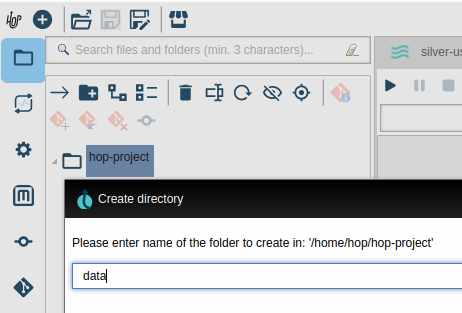

Copy the bronze CSV files from your laptop into it.

```bash
docker cp ./hop-project/data/bronze 'hop-web:/home/hop/hop-project/data/bronze'
```

## Users pipeline

Create the pipeline.

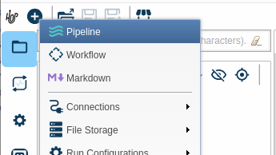

Create the sub-directory `/home/hop/hop-project/pipelines` first, then save the pipeline in it as `silver-users.hpl`.

Click "Edit the pipeline properties" to add the parameter `DATA_ROOT` with the value `${PROJECT_HOME}/data`.

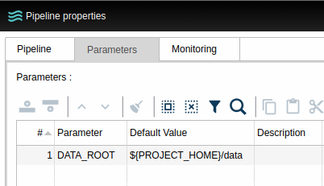

Add and configure the transforms to build up the data pipeline.

### Text file input

Use `Text file input` rather than `CSV File Input`: the `address` field spans two lines inside quotes, and the transform must accept line breaks in enclosed fields. Click on the canvas to open the transform selection box.

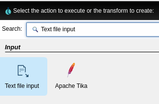

Click the transform icon and select `Edit` to open its configuration dialog.

- File tab:
  - File: `${DATA_ROOT}/bronze/users.csv`, then click "Add" on the right-hand side
- Content tab:
  - "Separator": `,`
  - "Enclosure": `"`
  - "Allow breaks in enclosed fields": checked
  - "Header": checked
- Fields tab:
  - Click `Get Fields`, and make sure the following is defined

| Name      | Type   | Format     |
| --------- | ------ | ---------- |
| uuid      | String |            |
| username  | String |            |
| name      | String |            |
| sex       | String |            |
| address   | String |            |
| mail      | String |            |
| birthdate | Date   | yyyy-MM-dd |

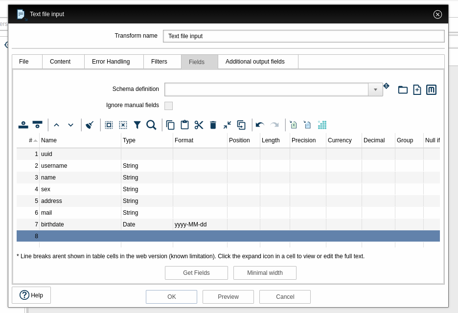

Click the "Preview" button to display the first rows and check that `address` is a single field containing a line break, not two rows.

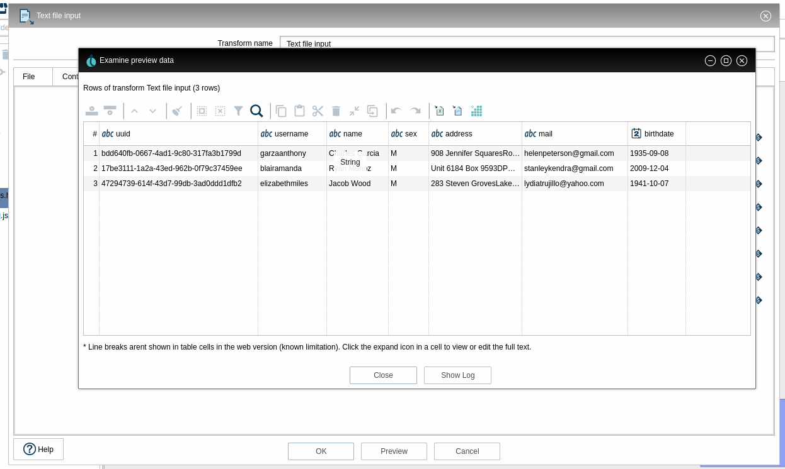

### String operations

Click on the canvas again and choose the `String operations` transform. Configure it with the following values.

| In stream field | Trim | Lower/Upper |
| --------------- | ---- | ----------- |
| username        | both |             |
| name            | both |             |
| sex             | both | upper       |
| mail            | both | lower       |

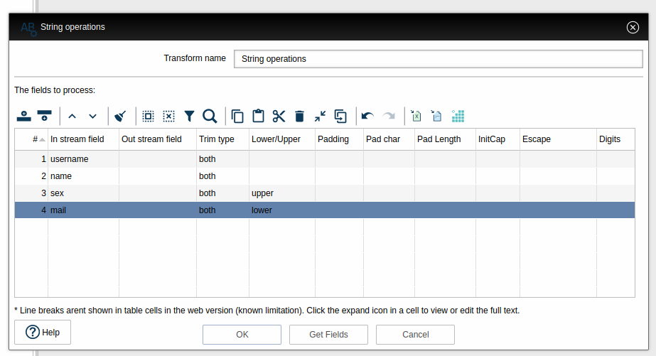

### Create the hops

Clicking the `Text file input` transform opens a menu. Choose `Create hop` and link it to the next transform, `String operations`. Repeat this step for the following transforms. Some transforms ask you to choose between "Main output of transform" and "Error handling of transform".

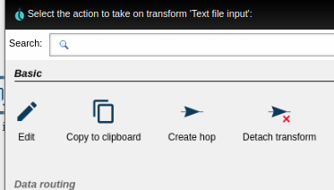

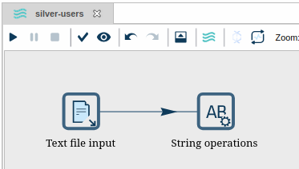

### Select values

In the "Select and Alter" tab, select all the columns and rename `uuid` to `user_id` and `mail` to `email`.

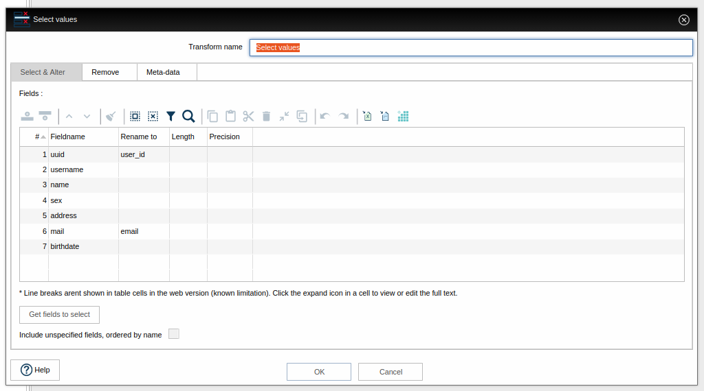

### Regex evaluation

Split `address` into four fields with a single regular expression applied to the `address` field.

Click on the canvas and choose the `Regex evaluation` transform. Configure it as follows.

- "Field to evaluate": `address`
- "Create fields for capture groups": checked
- "Regex expression":

  ```text
  ^([^\n]*)\n(?:(.+), )?.*?([A-Z]{2}) ([0-9]{5})$
  ```

- "Capture group fields":

  | Group | Field    |
  | ----- | -------- |
  | 1     | street   |
  | 2     | city     |
  | 3     | state    |
  | 4     | zip_code |

Military addresses such as `DPO AP 09617` have no city: the optional group does not match.

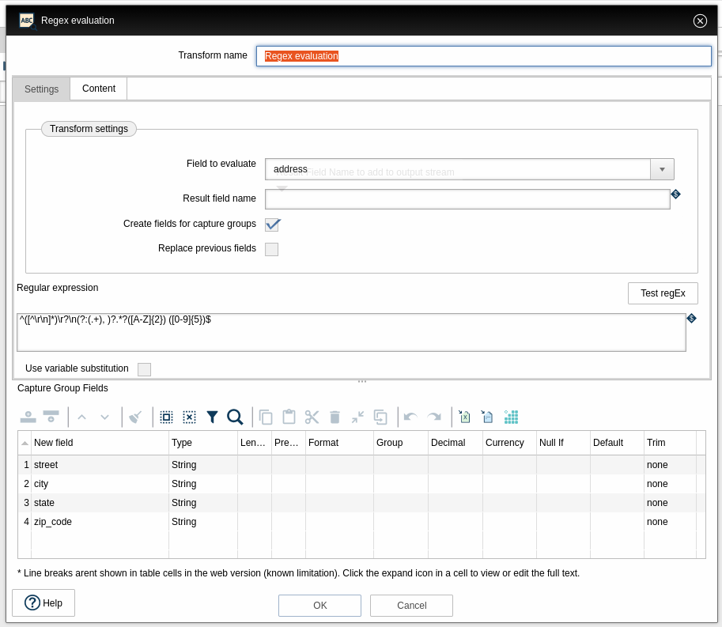

### Filter rows

Condition: `user_id` is not null AND `email` contains `@`.

The following options are set automatically once you create the hops from this transform to the next ones.

- "Send 'True' data to transform": send to the `Parquet file output` transform
- "Send 'False' data to transform": send to the `Text file output` transform, which writes `${DATA_ROOT}/quarantine/users` (the quarantine of the ETL/ELT module)

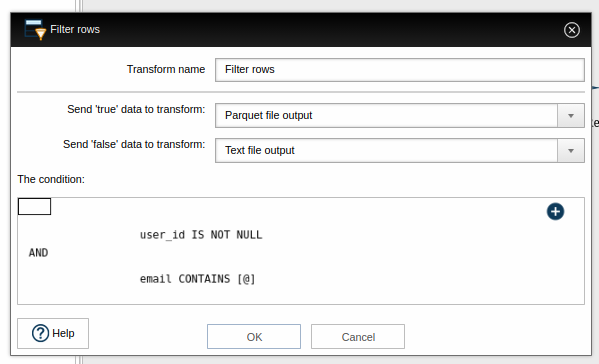

### Parquet file output

Create a `hop` between `Filter rows` and `Parquet file output` with "Result is TRUE" first: the "Get Fields" button needs the fields of the previous transform.

Select and order the columns `user_id`, `username`, `name`, `sex`, `email`, `birthdate`, `street`, `city`, `state`, `zip_code`. Click the "Get Fields" button at the bottom of the dialog to retrieve the fields from the previous transform.

- "Base File name": `${DATA_ROOT}/silver/hop/users`

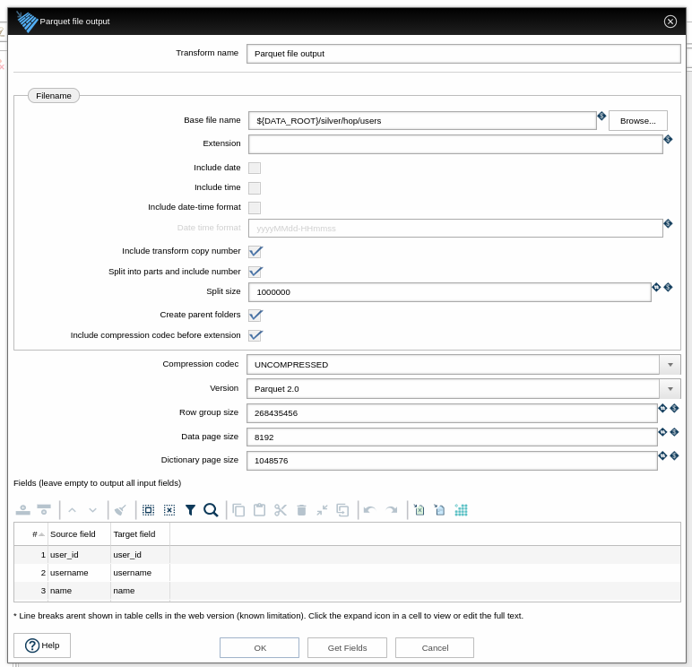

### Text file output

- "Filename": `${DATA_ROOT}/quarantine/users`
- "Create parent folder": checked
- "Include date in filename": checked
- "Include time in filename": checked
- "Do not create file at start": checked

Once configured, create a `hop` between `Filter rows` and `Text file output` with "Result is FALSE".

### Pipeline check

The finished pipeline will look like this.

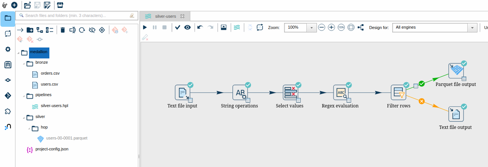

### Pipeline execution

Run the pipeline by clicking the "play" button above the canvas, with the "Pipeline run configuration" set to `local`.

Download the output Parquet files to your laptop.

```bash
docker cp 'hop-web:/home/hop/hop-project/data/silver' ./hop-project/data
```

The `docker cp` command creates `./hop-project/data/silver/hop/` on your laptop with the users Parquet files. Upload them to your bucket in Onyxia:

1. Open "My Files" in Onyxia and go to your bucket.
2. Create the folders `silver/hop/` if they do not exist.
3. Upload the `users*.parquet` files from `./hop-project/data/silver/hop/` into it.

### Verification

Verify that the Parquet file exists in the S3 bucket, in the VSCode PySpark terminal.

```bash
aws s3 --profile default ls s3://$LAB_BUCKET_NAME/silver/hop/
```

Check the Parquet output with DuckDB in the VSCode PySpark terminal. If the command fails due to the outdated AWS credential, redo the first section of the [DuckDB lab](../04.sql-analytics/lab-duckdb.md).

```bash
duckdb -init init.sql -c "
  SELECT count(*) AS users,
         count(city) AS with_city
  FROM read_parquet(getvariable('bucket') || '/silver/hop/users*.parquet')
"
#> ┌───────┬───────────┐
#> │ users │ with_city │
#> │ int64 │   int64   │
#> ├───────┼───────────┤
#> │    50 │        44 │
#> └───────┴───────────┘
```

Expected: 50 users, 44 with a city. The 6 others have a military address (`DPO`, `APO`) without a city. If you completed the Spark lab, the numbers must match.

## Orders pipeline

Download the pre-defined [`silver-orders.hpl`](./lab/pipelines/silver-orders.hpl) from the class module in the `hop-web` container.

```bash
FILE_URL=<pipeline-file-url-in-class-repo>
docker exec hop-web curl -fsSL -o /home/hop/hop-project/pipelines/silver-orders.hpl "${FILE_URL}"
```

Run the users pipeline first: the orders pipeline reads its output to find the users that exist. Open the provided `${PROJECT_HOME}/pipelines/silver-orders.hpl` and read it from left to right, then the second branch below it. It applies the rules of the Spark lab and adds a check on the user, as the dbt `relationships` test does:

| Transform                          | Role                                                                                                      |
| ---------------------------------- | --------------------------------------------------------------------------------------------------------- |
| Text file input                    | Declared fields, all `String`: `uuid`, `user_uuid`, `date`, `quantity`, `product`                         |
| String cut                         | Keeps the first 23 characters of `date` in `date_ms`, down to the millisecond                             |
| String operations                  | Trim and lower `product`                                                                                  |
| Select values                      | Rename to `order_id`, `user_id`, `ordered_at`; cast `date_ms` to `Date` and `quantity` to `Integer`       |
| Get file names, Parquet file input | Second branch: reads `user_id` from the silver users written by the previous pipeline                     |
| Stream lookup                      | Looks up each order's `user_id` in the users branch and returns it as `known_user_id`, empty if not found |
| Filter rows                        | "TRUE" (user found) continues. "FALSE" (unknown user) goes to the quarantine                              |
| Text file output                   | `${DATA_ROOT}/quarantine/orders`, created only if at least one order is rejected                          |
| Sort rows                          | By `order_id` ascending, `ordered_at` descending                                                          |
| Unique rows                        | On `order_id`, keeps the first row of each key, the most recent one                                       |
| Parquet file output                | `${DATA_ROOT}/silver/hop/orders`                                                                          |

The provided pipeline defaults `DATA_ROOT` to the S3 bucket. In the run dialog, set the `DATA_ROOT` parameter to `${PROJECT_HOME}/data`, then run it. Download the output Parquet file to your laptop.

```bash
docker cp 'hop-web:/home/hop/hop-project/data/silver' ./hop-project/data
```

Upload the `orders*.parquet` files from `./hop-project/data/silver/hop/` to `silver/hop/` in your bucket, as for the users.

### Verification

Check the Parquet output with DuckDB in the VSCode PySpark terminal.

```bash
duckdb -init init.sql -c "
  SELECT count(*) AS orders, sum(quantity) AS units,
         min(ordered_at) AS first_order, max(ordered_at) AS last_order
  FROM read_parquet(getvariable('bucket') || '/silver/hop/orders*.parquet')
"
#> ┌────────┬────────┬────────────────────────────┬────────────────────────────┐
#> │ orders │ units  │        first_order         │         last_order         │
#> │ int64  │ int128 │  timestamp with time zone  │  timestamp with time zone  │
#> ├────────┼────────┼────────────────────────────┼────────────────────────────┤
#> │   5000 │  14976 │ 2020-01-01 00:00:20.916+00 │ 2020-01-05 03:57:50.945+00 │
#> └────────┴────────┴────────────────────────────┴────────────────────────────┘
```

Expected: 5000 orders, from `2020-01-01 00:00:20.916` to `2020-01-05 03:57:50.945`. The values are truncated to the millisecond, not rounded: the Spark output keeps the microseconds (`.916787` and `.945413`).

## Questions

- Why does `Unique rows` need a `Sort rows` before it? What does Spark do instead?
- Compare the users pipeline with the `stg_users` DataFrame of the Spark lab.

## Commit

Copy the Hop project from the container into your lab repository, then commit it without the `data/` directory.

```bash
docker cp 'hop-web:/home/hop/hop-project' .
```

```bash
cd ..
git add ./lab_hop/hop-project/
git rm -r --cached ./lab_hop/hop-project/data # don't commit data/
git commit -m "feat(hop-lab): add Hop project for the Hop basic lab"
git push
```

Stop the container when you have finished:

```bash
docker stop hop-web
```

---

_The content of this document, including all text, images, and associated materials, is the exclusive property of
Adaltas and is protected by applicable copyright laws. Unauthorized distribution, reproduction, or sharing of this
content, in whole or in part, is strictly prohibited without the express written consent of the author(s). Any
violation of this restriction may result in legal action and the imposition of penalties as prescribed by law._
