# Lab: Bronze to silver with Hop

Use Apache Hop Web to construct bronze to silver pipeline.

## Objectives

- Build the silver `users` pipeline with an approach similar to the [Spark lab](../07.sparksql-and-dataframes/lab-pyspark-silver.md)
- Read and run the provided silver `orders` [pipeline](./lab/pipelines/silver-orders.hpl)
- Check the result using DuckDB

## Prerequisites

- A Hop Web deployed with the [previous lab](./lab-1-deployment.md)
- A web page of Hop Web is ready

## Project registration

Perform the following steps in "Hop Web" web page.

First, register the project with the "suitcase" button in the bottom-left corner.

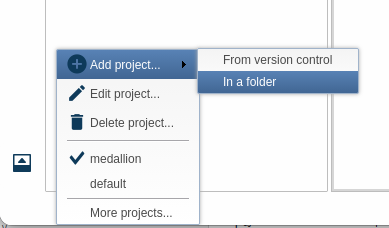

Enter the following values in the dialog box.

- "Name": `hop-project`
- "Home folder": `/home/hop/hop-project`
- "Configuration file": `project-config.json`

Configure the environment below.

## Environment configuration

- General tab:
  - "Name": `hop-project-development`
  - "Purpose" `Development`
  - "Project": `hop-project`
- Configuration files
  | Filename |
  | ------------------------------------ |
  | ${PROJECT_HOME}/hop-project-env.json |

Select `hop-project-env.json` file and click "Edit" button to define the environment variables.

| Variable name   | Value                          |
| --------------- | ------------------------------ |
| LAB_BUCKET_NAME | user-gollum                    |
| AWS_S3_ENDPOINT | s3.seaweedfs.adm.adaltas.cloud |

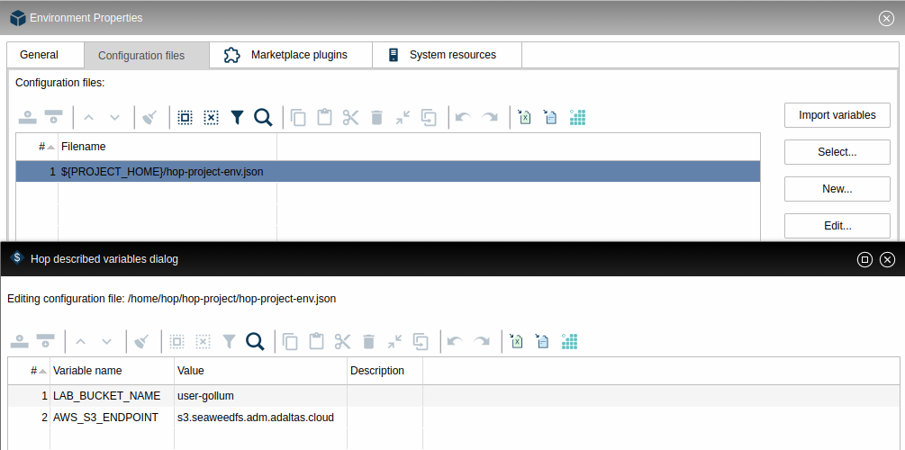

Once finished, click "Ok", and then click "Yes" to apply the configuration to the project.

## S3 connection

Hop Web reads and writes the buckets through Hop's virtual filesystem. A custom endpoint such as the one of Onyxia is set in an S3 Connection metadata object.

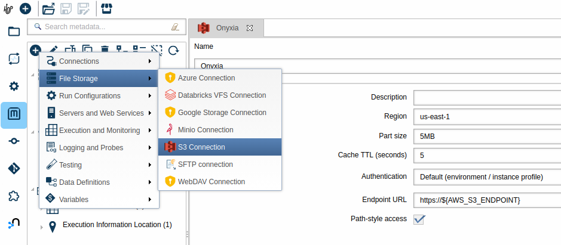

In Hop Web, open the metadata pane (`m` icon), create an "S3 Connection" and save it in the project:

- "Name": `onyxia`. The name is the URL scheme: paths read `onyxia://<bucket>/silver/hop/...`
- "region": `us-east-1`
- "Authentication type": `Default`. (The credentials are read from the `AWS_ACCESS_KEY_ID`, `AWS_SECRET_ACCESS_KEY` and `AWS_SESSION_TOKEN` environment variables of the `Job`. No credential is written in the project.)
- "Endpoint URL": `https://${AWS_S3_ENDPOINT}`
- "Path-style access": checked

The runs on your laptop in this lab read the local files, so the connection is only used by the `Job`.

## Users pipeline

Create the pipeline.

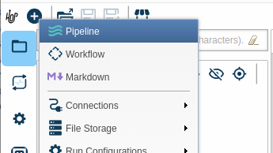

Create the sub-directory `/home/hop/hop-project/pipelines` first, then save the pipeline in it as `silver-users.hpl`.

Click the "Edit the pipeline properties" to add the parameter `DATA_ROOT` with the value of your bucket name `onyxia://${LAB_BUCKET_NAME}`. The pipelines read and write under the `DATA_ROOT` parameter.

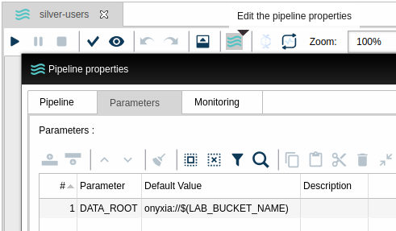

Add and configure the transforms to build up the data pipeline.

### Text file input

Use `Text file input` rather than `CSV File Input`: the `address` field spans two lines inside quotes, and the transform must accept line breaks in enclosed fields. Click on the canvas to open the transform selection box.

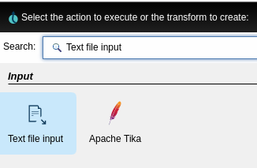

Click the transform icon and select `Edit` to open its configuration dialog.

- File tab:
  - File: `${DATA_ROOT}/bronze/users.csv`, then click "Add" on the right-hand side
- Content tab:
  - "Separator": `,`
  - "Enclosure": `"`
  - "Allow breaks in enclosed fields": checked
  - "Header": checked
- Fields tab:
  - Click `Get Fields`, and make sure the following is defined

| Name      | Type   | Format     |
| --------- | ------ | ---------- |
| uuid      | String |            |
| username  | String |            |
| name      | String |            |
| sex       | String |            |
| address   | String |            |
| mail      | String |            |
| birthdate | Date   | yyyy-MM-dd |

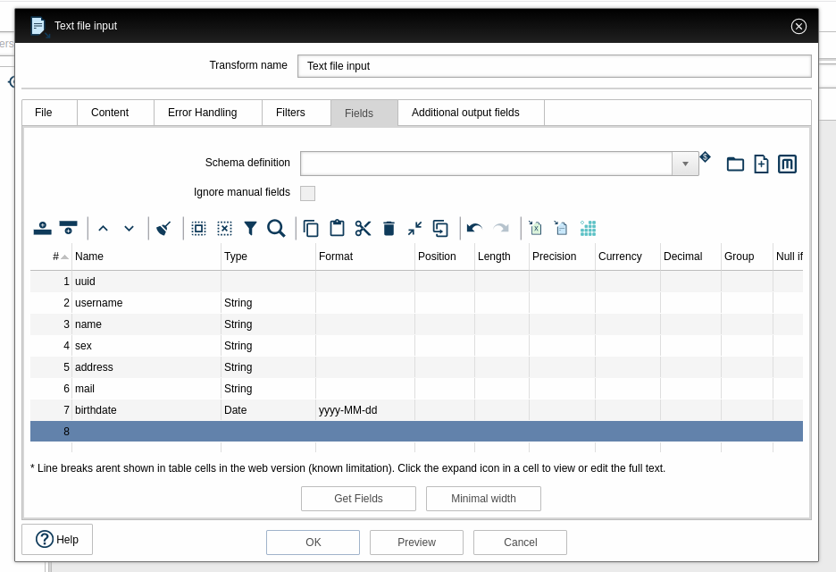

Click the "Preview" button to display the first rows and check that `address` is a single field containing a line break, not two rows.

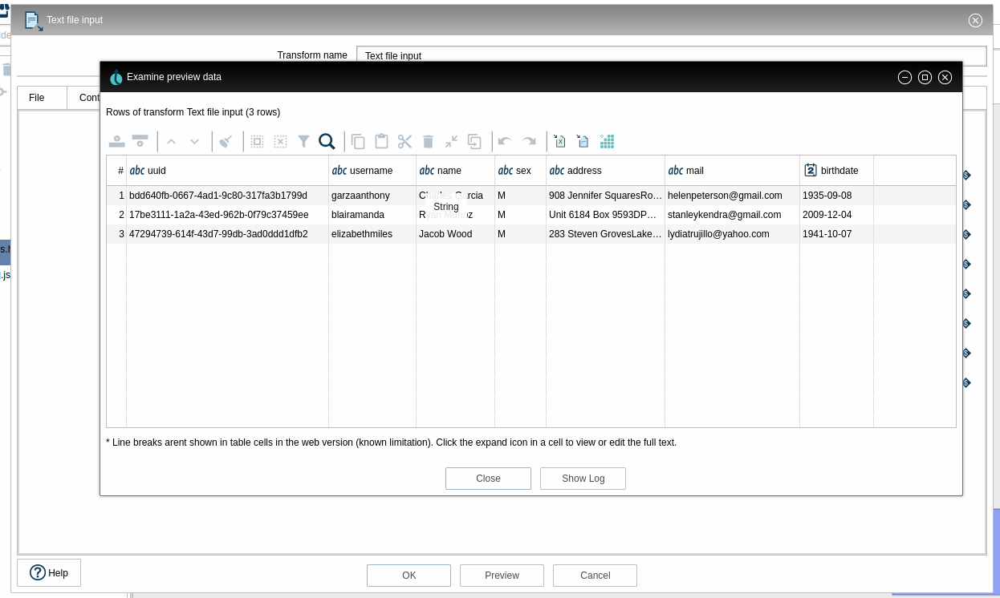

### String operations

Click on the canvas again and choose the `String operations` transform. Configure it with the following values.

| In stream field | Trim | Lower/Upper |
| --------------- | ---- | ----------- |
| username        | both |             |
| name            | both |             |
| sex             | both | upper       |
| mail            | both | lower       |

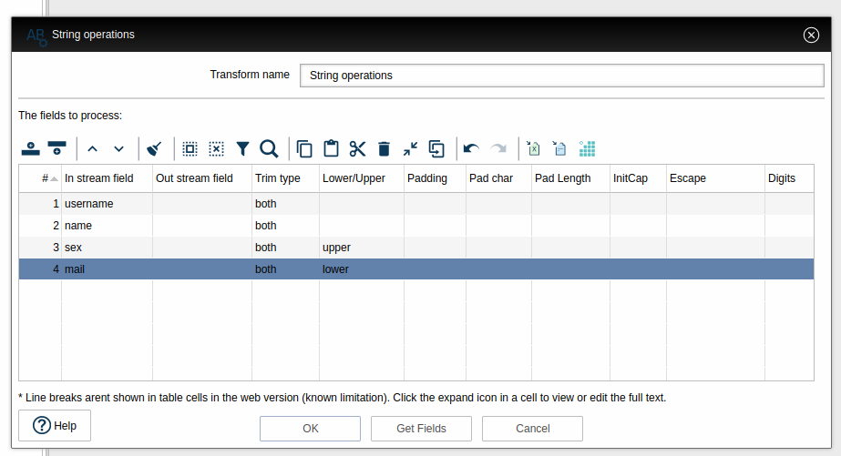

### Create the hops

Clicking the `Text file input` transform opens a menu. Choose `Create hop` and link it to the next transform, `String operations`. Repeat this step for the following transforms. Some transforms ask you to choose between "Main output of transform" and "Error handling of transform".

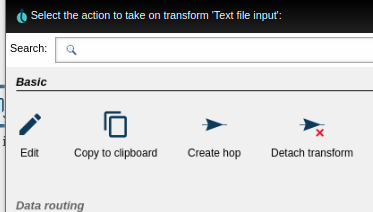

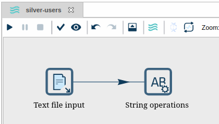

### Select values

In the "Select and Alter" tab, select all the columns and rename `uuid` to `user_id` and `mail` to `email`.

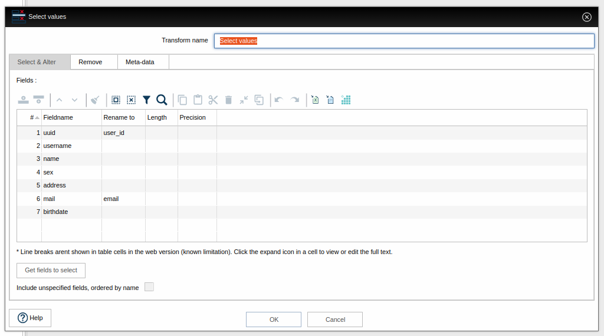

### Regex evaluation

Split `address` into four fields with a single regular expression applied to the `address` field.

Click on the canvas and choose the `Regex evaluation` transform. Configure it as follows.

- "Field to evaluate": `address`
- "Create fields for capture groups": checked
- "Regex expression":

  ```text
  ^([^\n]*)\n(?:(.+), )?.*?([A-Z]{2}) ([0-9]{5})$
  ```

- "Capture group fields":

  | Group | Field    |
  | ----- | -------- |
  | 1     | street   |
  | 2     | city     |
  | 3     | state    |
  | 4     | zip_code |

Military addresses such as `DPO AP 09617` have no city: the optional group does not match.

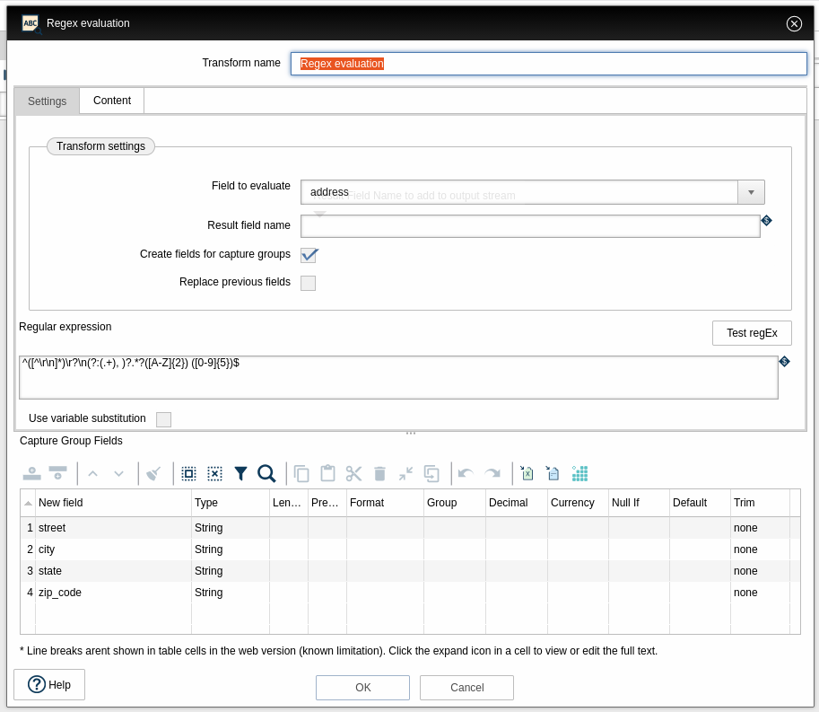

### Filter rows

Condition: `user_id` is not null AND `email` contains `@`.

The following options are set automatically once you create the hops from this transform to the next ones.

- "Send 'True' data to transform": send to the `Parquet file output` transform
- "Send 'False' data to transform": send to the `Text file output` transform, which writes `${DATA_ROOT}/quarantine/users` (the quarantine of the ETL/ELT module)

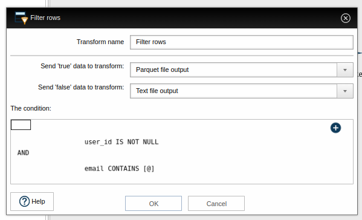

### Parquet file output

Select and order the columns `user_id`, `username`, `name`, `sex`, `email`, `birthdate`, `street`, `city`, `state`, `zip_code`. Click the "Get Fields" button at the bottom of the dialog to retrieve the fields from the previous transform. You will have to create a hop between `Filter rows` and `Parquet file output` first.

- "Base File name": `${DATA_ROOT}/silver/hop/users`

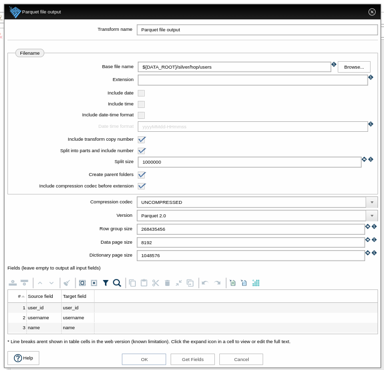

Once configured, create a `hop` between `Filter rows` and `Parquet file output` with "Result is TRUE".

### Text file output

- "Filename": `${DATA_ROOT}/quarantine/users`
- "Create parent folder": checked
- "Include date in filename": checked
- "Include time in filename": checked
- "Do not create file at start": checked

Once configured, create a `hop` between `Filter rows` and `Text file output` with "Result is FALSE".

### Pipeline check

The finished pipeline will look like this.

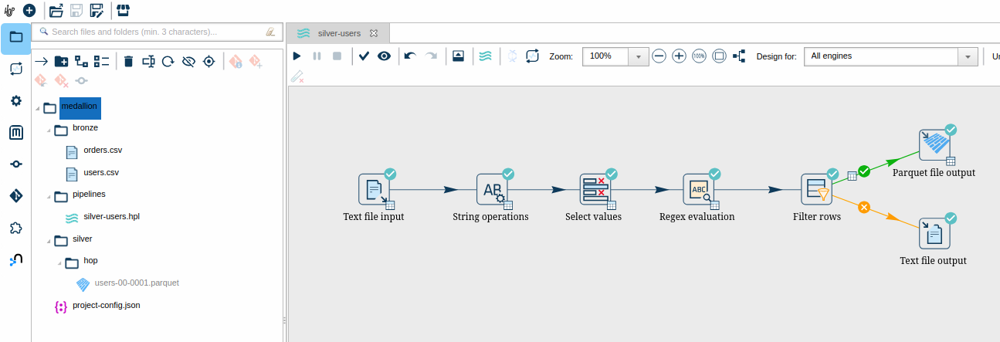

### Pipeline execution

Run the pipeline by clicking the "play" button above the canvas, with the "Pipeline run configuration" set to `local`.

### Verification

Verify that the parquet file exists in the S3 bucket.

```bash
aws s3 --profile default ls s3://$LAB_BUCKET_NAME/silver/hop/.
```

Check the Parquet output with DuckDB in the VSCode PySpark terminal. If the command fails due to the outdated AWS credential, redo the first section of the [DuckDB lab](../04.sql-analytics/lab-duckdb.md).

```bash
duckdb -init init.sql -c "
  SELECT count(*) AS users,
         count(city) AS with_city
  FROM read_parquet(getvariable('bucket') || '/silver/hop/users*.parquet')
"
#> ┌───────┬───────────┐
#> │ users │ with_city │
#> │ int64 │   int64   │
#> ├───────┼───────────┤
#> │    50 │        44 │
#> └───────┴───────────┘
```

Expected: 50 users, 44 with a city. The 6 others have a military address (`DPO`, `APO`) without a city. If you completed the Spark lab, the numbers must match.

## Orders pipeline

Download the pre-defined [`silver-orders.hpl`](./lab/pipelines/silver-orders.hpl) from the class module into Hop Web pod.

```bash
FILE_URL="https://raw.githubusercontent.com/adaltas/ece-bigdata-2026-fall/refs/heads/main/11.hop/lab/pipelines/silver-orders.hpl"
POD=$(kubectl get pod -l app.kubernetes.io/name=hop-web -o jsonpath='{.items[0].metadata.name}')
kubectl exec ${POD} -- curl -s -o "/home/hop/hop-project/pipelines/silver-orders.hpl" ${FILE_URL}
```

Run the users pipeline first: the orders pipeline reads its output to find the users that exist. Open the provided `${PROJECT_HOME}/pipelines/silver-orders.hpl` and read it from left to right, then the second branch below it. It applies the rules of the Spark lab and adds a check on the user, as the dbt `relationships` test does:

| Transform                          | Role                                                                                                      |
| ---------------------------------- | --------------------------------------------------------------------------------------------------------- |
| Text file input                    | Declared fields, all `String`: `uuid`, `user_uuid`, `date`, `quantity`, `product`                         |
| String cut                         | Keeps the first 23 characters of `date` in `date_ms`, down to the millisecond                             |
| String operations                  | Trim and lower `product`                                                                                  |
| Select values                      | Rename to `order_id`, `user_id`, `ordered_at`; cast `date_ms` to `Date` and `quantity` to `Integer`       |
| Get file names, Parquet file input | Second branch: reads `user_id` from the silver users written by the previous pipeline                     |
| Stream lookup                      | Looks up each order's `user_id` in the users branch and returns it as `known_user_id`, empty if not found |
| Filter rows                        | "TRUE" (user found) continues. "FALSE" (unknown user) goes to the quarantine                              |
| Text file output                   | `${DATA_ROOT}/quarantine/orders`, created only if at least one order is rejected                          |
| Sort rows                          | By `order_id` ascending, `ordered_at` descending                                                          |
| Unique rows                        | On `order_id`, keeps the first row of each key, the most recent one                                       |
| Parquet file output                | `${DATA_ROOT}/silver/hop/orders`                                                                          |

### Verification

Check the Parquet output with DuckDB in the VSCode PySpark terminal.

```bash
duckdb -init init.sql -c "
  SELECT count(*) AS orders, sum(quantity) AS units,
         min(ordered_at) AS first_order, max(ordered_at) AS last_order
  FROM read_parquet(getvariable('bucket') || '/silver/hop/orders*.parquet')
"
#> ┌────────┬────────┬────────────────────────────┬────────────────────────────┐
#> │ orders │ units  │        first_order         │         last_order         │
#> │ int64  │ int128 │  timestamp with time zone  │  timestamp with time zone  │
#> ├────────┼────────┼────────────────────────────┼────────────────────────────┤
#> │   5000 │  14976 │ 2020-01-01 00:00:20.916+00 │ 2020-01-05 03:57:50.945+00 │
#> └────────┴────────┴────────────────────────────┴────────────────────────────┘
```

Expected: 5000 orders, from `2020-01-01 00:00:20.916` to `2020-01-05 03:57:50.945`. The values are truncated to the millisecond, not rounded: the Spark output keeps the microseconds (`.916787` and `.945413`).

## Questions

- Why does `Unique rows` need a `Sort rows` before it? What does Spark do instead?
- Compare the users pipeline with the `stg_users` DataFrame of the Spark lab.

## Commit

Add the changes and commit to the remote repository.

```bash
kubectl cp "$POD":/home/hop/hop-project ./lab_hop/hop-project
git add ./lab_hop/hop-project/
git commit -m "feat(hop-lab): add Hop project for the Hop basic lab"
git push
```

---

_The content of this document, including all text, images, and associated materials, is the exclusive property of
Adaltas and is protected by applicable copyright laws. Unauthorized distribution, reproduction, or sharing of this
content, in whole or in part, is strictly prohibited without the express written consent of the author(s). Any
violation of this restriction may result in legal action and the imposition of penalties as prescribed by law._
